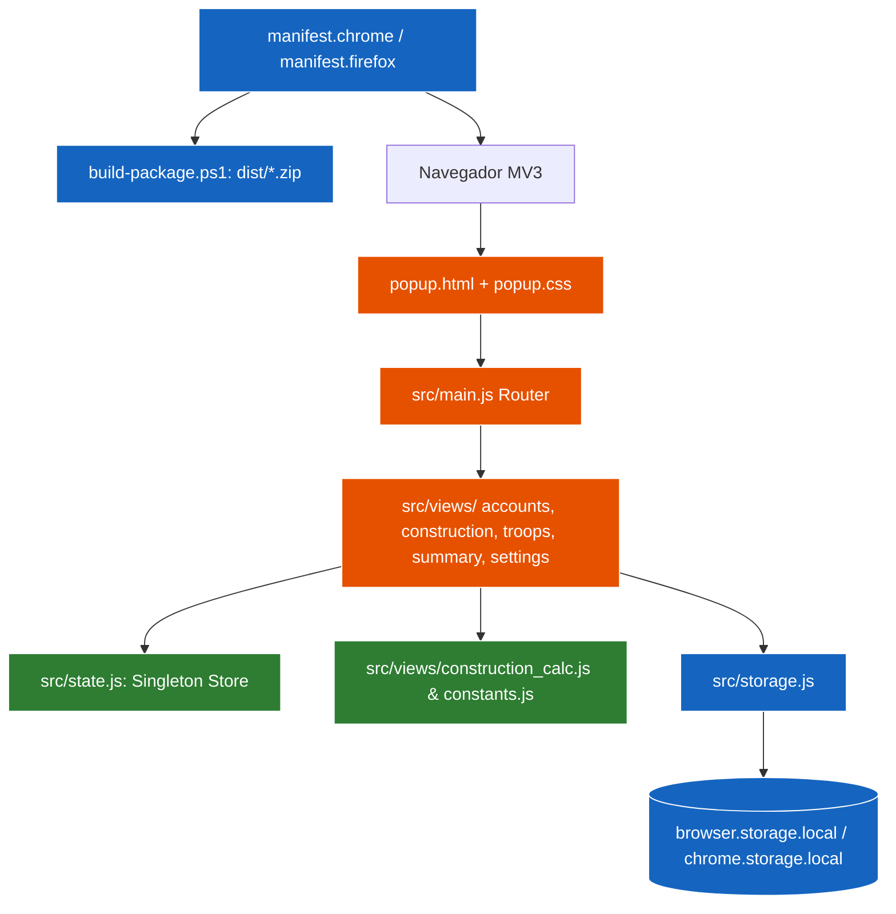

# 🏛️ Arquitectura Global del Proyecto — Ika Governor

> Última actualización: 2026-10-26 (Auditoría `$archi`: Cobertura 100% Hub & Spoke en `overview/architecture/`)

---

## 1. Visión General y Capas del Sistema

| Capa | Ubicación | Descripción Breve |
|---|---|---|
| **Presentation Shell** | `popup.html`, `popup.css`, `background.js` | Contenedor principal, paneles modales y side-panel listener |
| **Routing & Views** | `src/main.js`, `src/views/*.js` | Orquestador de vistas y módulos ES aislados (<250L objetivo) |
| **Domain & Algorithms** | `src/constants.js`, `src/views/construction_calc.js` | Catálogos de tropas, edificios, reducciones y algoritmos de coste |
| **State & Store** | `src/state.js` | Estado reactivo singleton en memoria y constructores DOM seguros |
| **Infrastructure / Data** | `src/storage.js`, `manifest.*.json` | Adaptador `storage.local` multi-cuenta y manifiestos MV3 |
| **Packaging & CI/CD** | `build-package.*`, `switch-manifest.*`, `dist/` | Scripts de empaquetado cross-browser con ZIP POSIX estricto |

---

## 2. Diagrama de Estado y Persistencia Global

---

## 3. Índice de Módulos (Subdocumentos de Dominio)

* 🏛️ **[Módulo de Construcción](./architecture/modules/construction.md):** Planificador de niveles, metas escalonadas (Madera..Platino) y cálculo de costes con descuentos.
* ⚔️ **[Módulo Militar (Tropas & Barcos)](./architecture/modules/troops.md):** Inventario de ejército, metas globales multi-ciudad y proyección de materiales faltantes.
* 👥 **[Módulo de Cuentas](./architecture/modules/accounts.md):** Gestión multi-servidor/mundo, conmutación de perfiles y aislamiento de datos.

---

## 4. Guías Transversales

* 🧭 **[Mapa Global de Rutas](./architecture/routes_map.md):** Enrutamiento por pestañas, modales y conmutador de cuentas.
* 🔄 **[Flujo de Datos y Persistencia](./architecture/core/data_flow.md):** Ciclo de vida del estado, hidratación síncrona y compatibilidad heredada.
* 📏 **[Reglas de Importación](./architecture/core/import_rules.md):** Convenciones de capas, callbacks inyectados y política de seguridad DOM.
