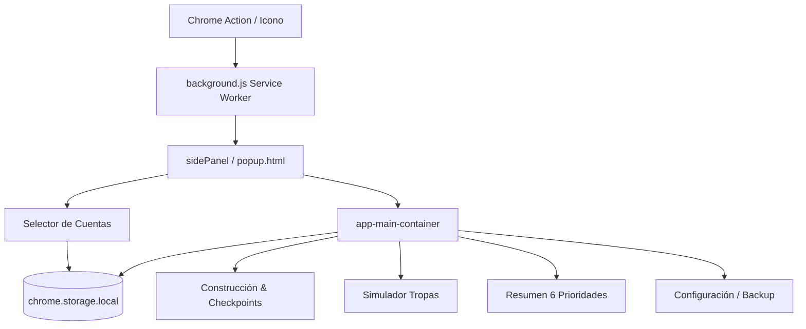

# 🏛️ Arquitectura Global del Proyecto — Ika Governor

> Última actualización: 2026-10-24

## 1. Visión General y Capas del Sistema

| Capa | Ubicación | Descripción Breve |
|---|---|---|
| **Presentation** | `popup.html`, `popup.css` | Vistas: Cuentas, Construcción, Tropas, Resumen, Configuración |
| **Logic & Controllers** | `popup.js` | Inicialización de sesión, handlers de UI, modales |
| **Domain** | `popup.js` | Fórmulas de costos (madera, mármol), metas 1-6, tropas |
| **Infrastructure** | `background.js`, `chrome.storage.local` | Service worker MV3 (side panel) y almacenamiento local |

## 2. Diagrama de Flujo y Persistencia

## 3. Componentes Clave en Refactor (Deuda Técnica)
* `popup.js`: Contiene lógica de vistas, dominio y persistencia mezcladas (>2500 líneas).
* `popup.css`: Estilos unificados (>1500 líneas).
