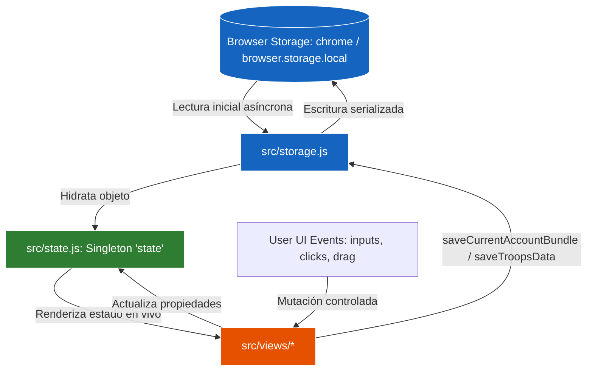

# 🔄 Flujo de Datos, Estado y Persistencia — Ika Governor

> Especificación del ciclo de vida de los datos, estado global reactivo y persistencia multi-navegador.

---

## 1. Diagrama de Flujo de Datos



---

## 2. Modelo de Estado Global (`src/state.js`)

El estado en memoria está centralizado en un singleton exportado `state` que contiene:

```javascript
export const state = {
  accounts: [],              // Lista de cuentas registradas [{id, name, world}]
  currentAccount: null,      // Cuenta activa actual
  cities: [],                // Array de IDs de ciudades de la cuenta activa
  cityLabels: {},            // Diccionario de metadatos { [cityId]: { name, abbr } }
  buildingsConfig: [],       // Lista de edificios con metas (meta1..meta6) y niveles por ciudad
  currentBuilding: null,     // Edificio seleccionado en la vista de construcción
  troopsData: {              // Registro militar
    activeTroopCity: null,
    cities: { [cityId]: { units: {}, ships: {} } }
  },
  isMetaPanelOpen: false,    // Estado del panel lateral de metas militares
  selectedMetaCities: new Set(),
  metaPanelInputs: { units: {}, ships: {} }
};
```

---

## 3. Persistencia Multi-Cuenta y Migración (`src/storage.js`)

- **Espacio de Nombres por Cuenta:** Cada cuenta persiste bajo la clave `ikagovernor_data_<accountId>`.
- **Índice Global de Cuentas:** Clave `ikagovernor_accounts` almacena el catálogo de perfiles.
- **Cuenta por Defecto:** Clave `ikagovernor_current_account` recuerda la última cuenta abierta para inicialización síncrona/rápida.
- **Migración Heredada (Legacy Fallback):** Si se detectan claves antiguas (`ikagovernor_cities`, `ikagovernor_troops`, etc.), se importan automáticamente a la cuenta por defecto `acc_default` sin pérdida de datos.
- **Seguridad en Escritura:** Todas las llamadas a `storage.local.set` encapsulan bundles completos para prevenir escrituras parciales o estados corruptos.
