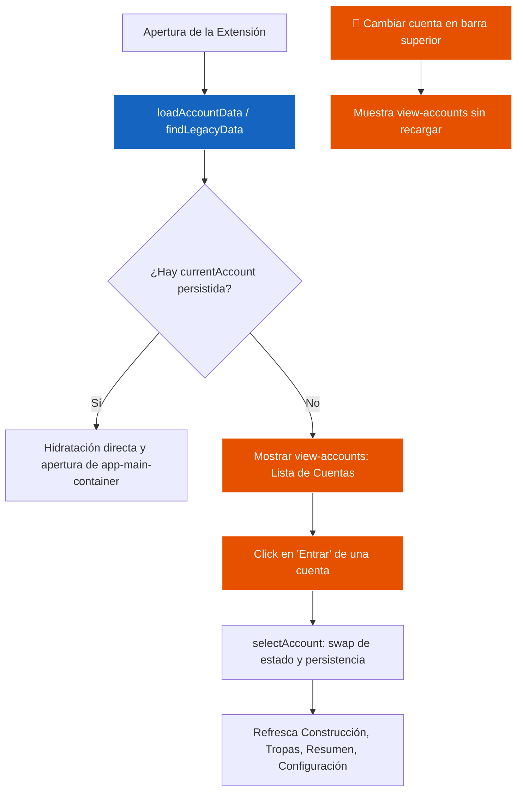

# 🏛️ Módulo de Cuentas & Multi-Entorno — Ika Governor

> Especificación técnica de gestión multi-servidor/mundo, conmutación de cuentas y persistencia aislada.

---

## 1. Archivos del Módulo

- **Controlador UI:** [src/views/accounts.js](file:///c:/Users/termo/Documents/GitHub/ikagovernor/src/views/accounts.js) (Lista de cuentas, modal de alta, confirmación de eliminación).
- **Servicio de Persistencia:** [src/storage.js](file:///c:/Users/termo/Documents/GitHub/ikagovernor/src/storage.js) (Aislamiento de bundles por `accountId`).

---

## 2. Flujo de Autenticación y Selección de Cuenta

---

## 3. Integridad de Datos
- Las cuentas se identifican por IDs únicos con prefijo `acc_`.
- La eliminación de cuenta limpia tanto el índice global (`ikagovernor_accounts`) como la clave de datos específica (`ikagovernor_data_<id>`).
