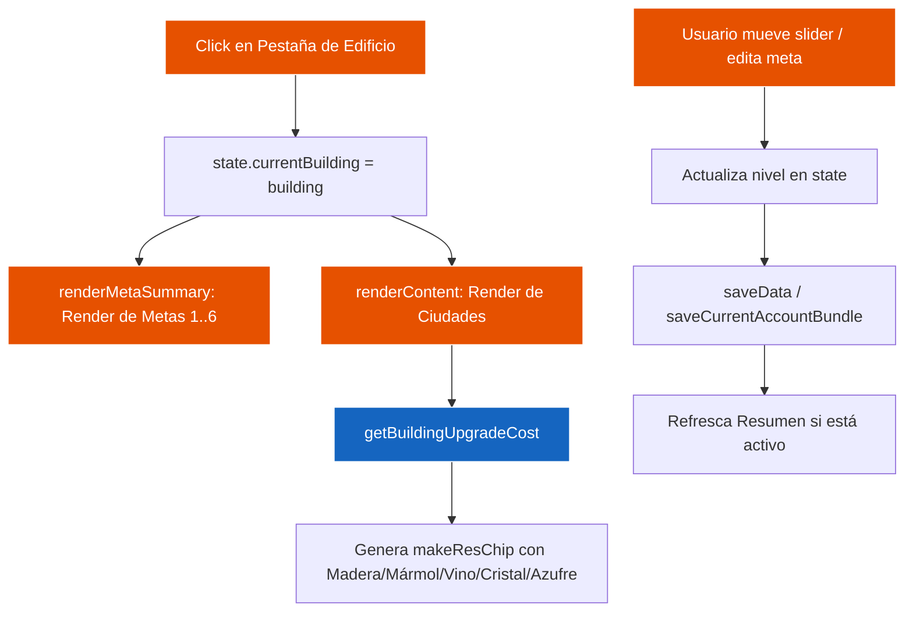

# 🏛️ Módulo de Construcción & Cálculo de Costos — Ika Governor

> Especificación técnica del planificador de niveles, metas escalonadas y proyección de recursos.

---

## 1. Archivos del Módulo

- **Controlador UI:** [src/views/construction.js](file:///c:/Users/termo/Documents/GitHub/ikagovernor/src/views/construction.js) (Pestañas de edificios, checkpoints, sliders y eventos).
- **Lógica de Dominio:** [src/views/construction_calc.js](file:///c:/Users/termo/Documents/GitHub/ikagovernor/src/views/construction_calc.js) (Fórmulas de coste exponencial y reducciones por investigación/edificio).

---

## 2. Flujo Operativo y Ciclo de Vida

---

## 3. Modelo de Metas Escalonadas

Cada edificio tiene asociadas 6 metas progresivas:
- `meta1`: Madera
- `meta2`: Cobre
- `meta3`: Verde
- `meta4`: Azul
- `meta5`: Dorado
- `meta6`: Platino

La función `getActiveTargetIndex(building)` determina cuál es la meta objetivo inmediata comparando el nivel más bajo que tienen las ciudades con respecto a cada umbral.
