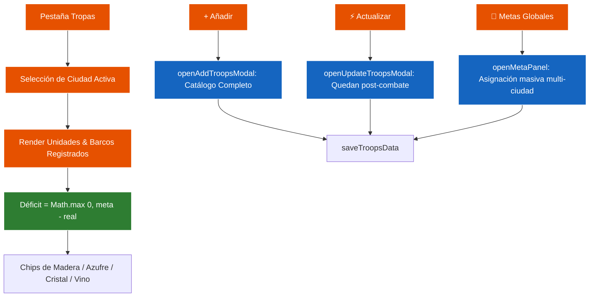

# ⚔️ Módulo Militar (Tropas & Barcos) — Ika Governor

> Especificación técnica del seguimiento de ejércitos, flotas, metas globales y cálculo de déficits.

---

## 1. Archivos del Módulo

- **Vista Principal:** [src/views/troops.js](file:///c:/Users/termo/Documents/GitHub/ikagovernor/src/views/troops.js) (Pestañas de colonias, inventario de unidades y cálculo de materiales faltantes).
- **Controlador de Metas y Modales:** [src/views/troops_meta.js](file:///c:/Users/termo/Documents/GitHub/ikagovernor/src/views/troops_meta.js) (Panel global multi-ciudad, modal de alta y modal de actualización rápida).
- **Catálogo de Tropas:** [src/constants.js](file:///c:/Users/termo/Documents/GitHub/ikagovernor/src/constants.js) (`TROOP_DEFINITIONS.units` y `TROOP_DEFINITIONS.ships`).

---

## 2. Diagrama de Interacción Militar

---

## 3. Seguridad DOM
Todas las filas dinámicas de tropas, modales y tarjetas se construyen mediante `document.createElement` e interpolación segura con `textContent` y `makeResChip()`, asegurando total conformidad con las políticas de Mozilla AMO.
