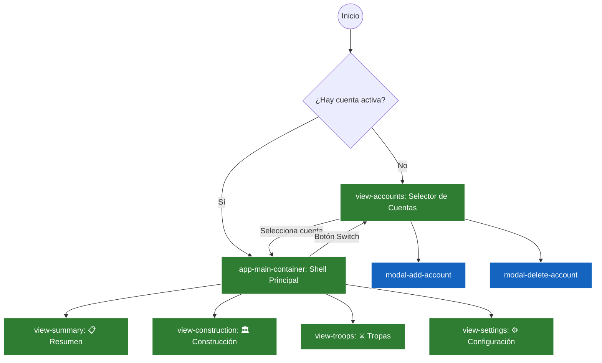

# 🧭 Mapa Global de Rutas y Navegación — Ika Governor

> Vista estructurada del flujo de pantallas, navegación por pestañas y modales de la extensión.

---

## 1. Diagrama de Navegación de Vistas

---

## 2. Pistas y Modales por Vista

### 🏛️ Vista de Cuentas (`view-accounts`)
- **Controlador:** [src/views/accounts.js](file:///c:/Users/termo/Documents/GitHub/ikagovernor/src/views/accounts.js)
- **Modales asociados:**
  - `#modal-add-account`: Formulario de creación de cuenta (Nombre, Servidor/Mundo).
  - `#modal-delete-account`: Confirmación destructiva de borrado de cuenta y datos asociados.

### 📋 Vista de Resumen (`view-summary`)
- **Controlador:** [src/views/summary.js](file:///c:/Users/termo/Documents/GitHub/ikagovernor/src/views/summary.js)
- **Componentes:**
  - `#summary-cards-container`: Próximas 6 construcciones recomendadas según checkpoints.
  - `#summary-troops-container`: Top 6 ciudades con mayor déficit de tropas y materiales faltantes.

### 🏛️ Vista de Construcción (`view-construction`)
- **Controlador:** [src/views/construction.js](file:///c:/Users/termo/Documents/GitHub/ikagovernor/src/views/construction.js) y [src/views/construction_calc.js](file:///c:/Users/termo/Documents/GitHub/ikagovernor/src/views/construction_calc.js)
- **Sub-navegación:**
  - Pestañas de Edificios (`#tabs`) con colores de meta mínima alcanzada.
  - Pestañas de Metas (`#meta-summary`) con indicadores (Madera, Cobre, Verde, Azul, Dorado, Platino).
  - Lista de Ciudades con sliders de nivel y chips de costo de mejora en tiempo real.
- **Acción Flotante:** `#btn-edit` para activar/desactivar el modo edición de niveles y metas.

### ⚔️ Vista Militar / Tropas (`view-troops`)
- **Controlador:** [src/views/troops.js](file:///c:/Users/termo/Documents/GitHub/ikagovernor/src/views/troops.js) y [src/views/troops_meta.js](file:///c:/Users/termo/Documents/GitHub/ikagovernor/src/views/troops_meta.js)
- **Sub-vistas y Paneles:**
  - Pestañas de Ciudades (`#troops-city-tabs`).
  - Panel de Metas Globales (`#troops-meta-panel`): Aplicación masiva multi-ciudad.
  - Secciones: Tropas Terrestres y Barcos de Guerra.
- **Modales asociados:**
  - `#modal-add-troops`: Alta de nuevas unidades en el registro de la ciudad.
  - `#modal-update-troops`: Actualización rápida post-combate ("Quedan...").

### ⚙️ Vista de Configuración (`view-settings`)
- **Controlador:** [src/views/settings.js](file:///c:/Users/termo/Documents/GitHub/ikagovernor/src/views/settings.js)
- **Funcionalidades:**
  - Reordenación arrastrando (*drag & drop*).
  - Edición en línea de nombres y abreviaturas de colonias.
  - Modal `#modal-confirm-delete` para eliminación de colonias.
