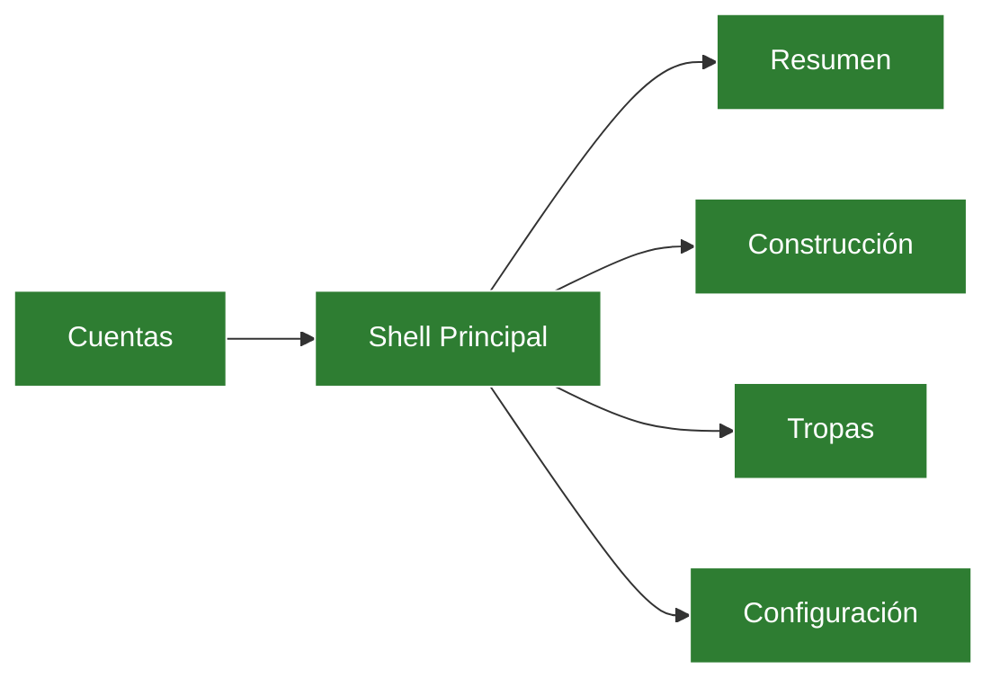

# Tracker: Arquitectura y Rutas — Ika Governor

## Mapa de navegación

`done` = auditado/verificado · `pending` = pendiente de modularizar (`:::pending`).

---

## Componentes por capa

| ID | Capa | Componente / Archivo | Estado | Notas |
|---|---|---|---|---|
| a1 | Presentation Shell | `popup.html`, `popup.css`, `background.js` | activo | Modularizar CSS pendiente (`d2`) |
| a2 | Router / App | `src/main.js` | activo | Inicialización y routing de pestañas |
| a3 | Vistas | `src/views/*.js` (7 módulos) | activo | Cero `innerHTML` dinámico (AMO compliant) |
| a4 | Dominio & Cálculo | `src/constants.js`, `src/views/construction_calc.js` | activo | Costos exponenciales y catálogo militar |
| a5 | Estado Central | `src/state.js` | activo | Singleton reactivo y helpers DOM |
| a6 | Persistencia | `src/storage.js` | activo | Multi-cuenta con `storage.local` y fallback |
| a7 | Empaquetado | `build-package.ps1`, `switch-manifest.ps1` | activo | ZIP con rutas POSIX estricto |

---

## Dependencias externas relevantes

| Paquete / API | Versión fijada | Propósito | Estado |
|---|---|---|---|
| WebExtensions API (MV3) | Chrome 109+ / Firefox 142+ | Runtime de extensión | `ok` |
| Vanilla JS (ES Modules) | ES2022 | Modularidad nativa sin bundlers | `ok` |

---

## Decisiones de arquitectura (ADR mínimo)

### [2026-10-26] Arquitectura Multi-Manifest con Empaquetado Staging
- **Contexto:** Firefox y Chrome difieren en requerimientos de Manifest V3 (`sidePanel` vs `sidebar_action`, `browser_specific_settings.gecko`, `data_collection_permissions`).
- **Decisión tomada:** Separar `manifest.chrome.json` y `manifest.firefox.json`. El script `build-package.ps1` crea un `.staging_<target>` efímero y empaqueta en ZIP con rutas POSIX forzadas (`/`).
- **Consecuencias / trade-offs:** Requiere usar `build-package.ps1` o `switch-manifest.ps1` al cambiar de navegador objetivo; garantiza 0 avisos en validación de tiendas.
- **Agente que decidió:** Gemini 3.8 Flash (via Antigravity IDE)

### [2026-10-26] Erradicación de `innerHTML` por API DOM Estándar
- **Contexto:** Linter de Mozilla AMO emitió 25 avisos de `Unsafe assignment to innerHTML` por variables dinámicas.
- **Decisión tomada:** Usar exclusivamente `document.createElement`, `textContent`, `append`, `replaceChildren()` y el helper `makeResChip()`.
- **Consecuencias / trade-offs:** Código ligeramente más verboso pero 100% seguro contra inyecciones y aprobación inmediata en AMO.
- **Agente que decidió:** Gemini 3.8 Flash (via Antigravity IDE)
